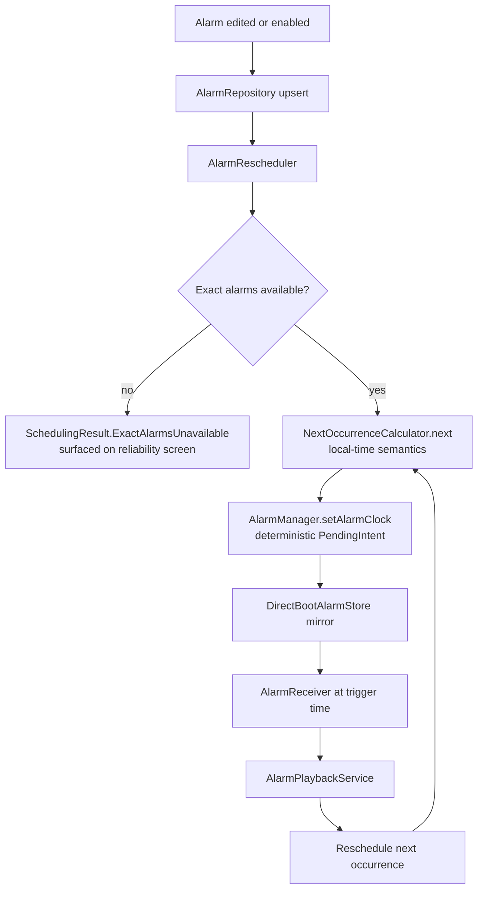
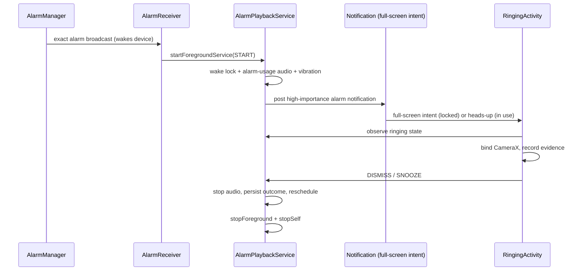
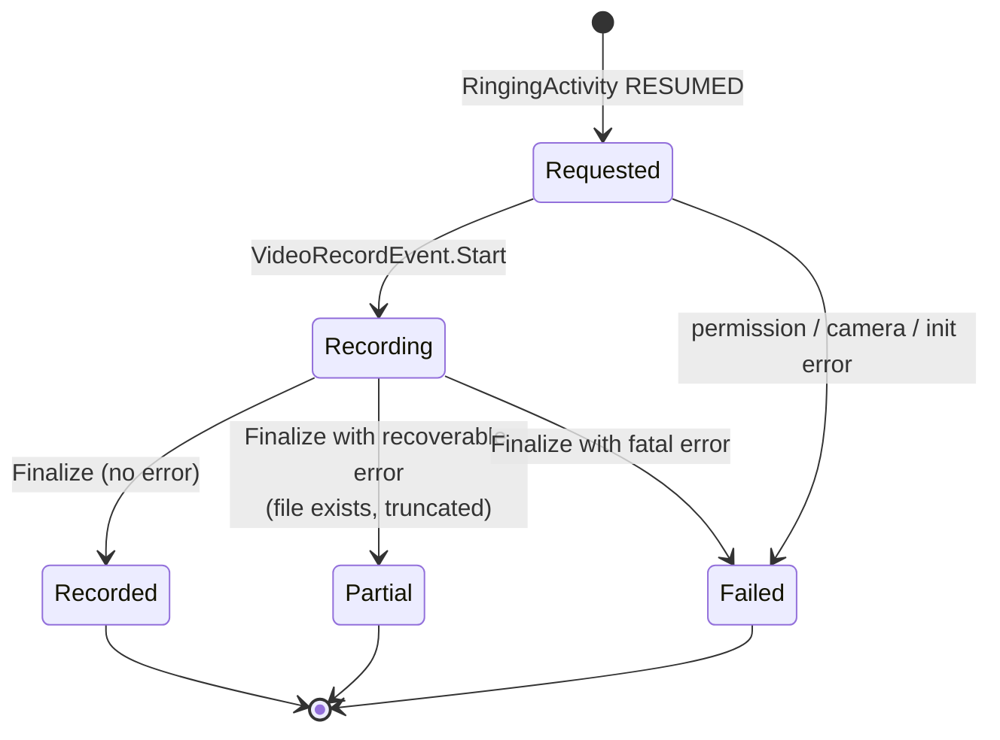
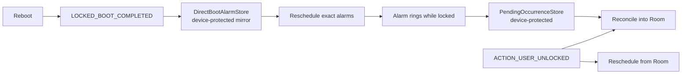

# UpYet — architecture

This document explains *how* the app is put together and *why*. The binding rules live in
[`/AGENTS.md`](../AGENTS.md); this file does not repeat them.

## 1. Layering and module map

Single Gradle module `:app`, organised by feature with explicit platform boundaries:

```text
dev.upyet
├── alarm
│   ├── domain      pure Kotlin: Alarm, Recurrence, NextOccurrenceCalculator, repository interfaces
│   ├── data        Room entities/DAOs/mappers, RoomAlarmRepository
│   ├── scheduling  AlarmScheduler, PendingIntent identity, AlarmReceiver, BootReceiver, rescheduler
│   ├── playback    AlarmPlaybackService, ringtone/vibration/wake lock, ringing session state
│   ├── ringing     RingingActivity, RingingViewModel, RingingScreen
│   └── ui          alarm list + editor
├── evidence
│   ├── domain      AlarmOccurrence, EvidenceSegment, statuses, repository interface
│   ├── data        Room entities/DAOs, EvidenceFileStore, RetentionCleaner
│   ├── camera      EvidenceSession (shared by both ringing screens), EvidenceCoordinator (CameraX)
│   └── ui          recording indicator, evidence player
├── history/ui      occurrence list + detail (alarm and timer occurrences, Timer badge)
├── timer
│   ├── domain      pure Kotlin: Timer, run-state transitions, remaining-time math from both anchors
│   ├── data        Room entities/mapper, RoomTimerRepository (mirrors to device-protected storage)
│   ├── scheduling  TimerScheduler (one exact alarm), TimerReceiver, TimerDiscovery, running/missed notices
│   ├── playback    TimerPlaybackService, one sound/vibration/wake lock for every ringing timer
│   ├── ringing     TimerRingingActivity, TimerRingingViewModel, timer occurrence for the showing
│   └── ui          timer list + wheel editor
├── worldclock
│   ├── domain      pure Kotlin: city search index, solar position for the night band, list rows
│   ├── data        bundled gazetteer + land outline loaders (res/raw, ADR 0011)
│   └── ui          map card, place list, drag reorder, city picker
├── intents         platform AlarmClock intents (SET_ALARM, SET_TIMER, DISMISS_*), ringing surfaces
├── stopwatch
│   ├── domain      pure Kotlin: Stopwatch (anchor, accumulated time, laps), ports
│   ├── data        StopwatchController, DataStore store, boot count, ongoing notice (id 1104)
│   └── ui          dial, digits, round buttons, lap list
├── settings        DataStore-backed settings (incl. the world clock list) + UI, Data sources screen
├── reliability/ui  diagnostics screen
├── core            time, database, directboot, notifications, logging, ui theme
└── navigation      NavHost and routes
```

Dependency direction is always `ui → domain ← data`. Domain code has no Android imports, which is what
makes recurrence and scheduling arithmetic unit-testable on the JVM.

## 2. Alarm scheduling lifecycle



Key properties:

* **One exact alarm per upcoming occurrence.** Recurrence is a rule, never a repeating alarm.
  `setRepeating()` and fixed `+24h` deltas break across DST and manual clock changes.
* **Deterministic identity.** The PendingIntent request code is derived from the alarm id and the
  occurrence kind (main vs snooze), so scheduling twice replaces rather than duplicates, and cancelling
  is exact. This is what makes `schedule`/`cancel` idempotent.
* **Rescheduling triggers**: boot (locked and unlocked), package replacement, `TIME_SET`,
  `TIMEZONE_CHANGED`, user unlock, exact-alarm access restored, and immediately after an alarm fires.
* **Failures are explicit.** `SchedulingResult` is a sealed type; a failed schedule never shows as an
  armed alarm in the UI.

## 3. Ringing lifecycle



Why this split: the service is the only component whose lifetime we control against process death,
window focus, task removal and Activity crashes. Ringing therefore lives entirely in the service, and
the Activity is a replaceable interaction surface. If the Activity never appears (full-screen intent
suppressed, device policy, crash), the alarm still rings and can be dismissed from the notification's
content intent — which opens the Activity rather than short-circuiting the recording experience.

The service also owns a hard timeout: if nobody interacts, it stops itself and the occurrence is
recorded as `TIMED_OUT`.

## 4. Evidence lifecycle



* A segment is created when recording is *requested*; `startedAt` is written only when CameraX emits
  `VideoRecordEvent.Start`. This is why the schema separates `requestedAt`, `startedAt`, `endedAt` and
  `finalizedAt` — pretending recording began at Activity creation would make the evidence dishonest.
* Losing the foreground ends the current segment. Becoming visible again inside the same ringing
  occurrence starts a **new** segment. Occurrence → segments is one-to-many precisely for this reason;
  files are never concatenated during capture, and history plays them in sequence.
* Every failure mode maps to an `EvidenceErrorCode` and is persisted with the occurrence, so the
  history screen can explain what happened instead of showing a blank.
* Dismissal is never gated on the camera: the dismiss path stops playback first and finalizes evidence
  best-effort afterwards.

## 5. Direct Boot strategy



* Alarm-critical components are `directBootAware`. Everything they need before first unlock lives in
  device-protected storage: alarm id, trigger time, snooze minutes, vibration flag, sound URI, and, for a
  timer, its label. `AGENTS.md` §11 permits a label in the minimal mirror; alarm labels are not mirrored,
  a deliberate choice, while a timer's label is, because the ringing screen has nothing else to name a
  ringing timer by before first unlock. History is never mirrored: device-protected storage is not the
  place for user content that is not required to ring.
* Any code reachable before unlock checks `UserManager.isUserUnlocked()` before touching Room or
  DataStore, and the Hilt graph on that path never eagerly constructs the database.
* Timers have their own mirror, `DirectBootTimerStore` (ADR 0008): id, run state, length, remaining at
  its anchor, wall-clock anchor, end instant, label, ringtone URI and the Timer evidence flag. No elapsed
  anchor, because elapsed realtime restarts at boot. Each record also says whether it was written while
  locked; on `USER_UNLOCKED`, `TimerMirrorReconciler` copies only those run states into Room, so
  reconciling is idempotent and never reverts an edit made after unlock. Room keeps the label, length and
  evidence flag, and a mirror record for a timer Room no longer has is dropped, never recreated.
* Timer scheduling (ADR 0008, ADR 0009) lives in `timer/scheduling/`. `TimerDiscovery` handles every event
  that is not the user's (boot, unlock, launch, expiry, `TIME_SET`, restored exact access) against Room once
  unlocked and the mirror before, under one lock. `TimerAlarmSync` then arms exactly one
  `setExactAndAllowWhileIdle(ELAPSED_REALTIME_WAKEUP)` alarm, fixed request code, for the earliest-ending
  timer, and posts or clears the `timer_missed` notice. `RoomTimerRepository` mirrors and re-arms on every
  write. A delivery carries the timer id and its wall-clock end; `Timer.onExpiry` rings only when that still
  matches. `TimerReceiver` takes `TIMEZONE_CHANGED` only to re-post the running notice (`onZoneChanged`): both anchors are zone-free, so a zone change re-arms nothing.
* Timer ringing (ADR 0008, AGENTS.md §8a) lives in `timer/playback/`. A validated expiry starts
  `TimerPlaybackService` (`mediaPlayback`, Direct-Boot aware), which runs its commands one at a time through
  `TimerRinging`: one sound, one vibration and one wake lock for every ringing timer, a set-holding
  `TimerRingingRegistry` the ringing screen observes, and Stop, +1 min and Stop all written back through
  `TimerDiscovery`'s lock, so they reach the mirror rather than Room before first unlock. The sound stops before
  anything is persisted. The service builds its own `AlarmSoundPlayer` and `AlarmVibrator` instead of taking
  the Hilt singletons, because sharing the alarm's `MediaPlayer` would let a timer silence a ringing alarm.
  `TimerNotifications` posts id 1101 on `timer_ringing`; its heads-up offers Stop and +1 min, or Stop all,
  only while no ringing timer has Timer evidence on (issue #14). It never calls `cancelUpcoming()`.
* The timer ringing screen (AGENTS.md §9a, issue #14 variant C) lives in `timer/ringing/`. The ringing
  notification's full-screen and content intents open `TimerRingingActivity` (Direct-Boot aware,
  `showWhenLocked`, `turnScreenOn`, screen kept on, keyguard never dismissed). `TimerRingingViewModel` reads
  `TimerRingingRegistry` and sends Stop, +1 min and Stop all to the service through `TimerRingingCommands`;
  the pure `timerRingingState` picks the focused timer (the user's choice while it rings, otherwise the one
  that started ringing last) and the queue. Recording runs while any ringing timer has Timer evidence on and
  stops when the last of them leaves (ADR 0010). A showing with every toggle off never touches the recorder.
* Occurrences that fire while locked are appended to a device-protected pending list
  (`PendingOccurrenceStore`) and merged into Room when the user unlocks. Each record carries an alarm / timer
  source discriminator: a recording-on timer showing before first unlock writes a timer record with its
  attribution and `DIRECT_BOOT_UNAVAILABLE` (`TimerShowingOccurrence`), and `PendingOccurrenceReconciler`
  dispatches on the source, so a timer record becomes a timer occurrence and never retires a one-time alarm.
  A record written before the discriminator existed decodes as an alarm record (ADR 0010).
* CameraX before first unlock is best-effort only: when it cannot initialize, the occurrence records
  `DIRECT_BOOT_UNAVAILABLE` and ringing/snooze/dismiss behave normally.

## 6. Storage ownership

| Data | Where | Why |
|---|---|---|
| Alarms, timers, occurrences, evidence metadata | Room (credential-protected) | relational queries, migrations, observable Flows |
| Alarm-critical mirror, timer mirror, pending occurrences | device-protected `SharedPreferences` | must be readable before first unlock |
| Settings (retention, defaults) | DataStore Preferences | simple key/value, async, no schema churn |
| Stopwatch anchor and laps | DataStore Preferences (`stopwatch`, credential-protected) | survives process death; no Direct Boot path, since a reboot resets it |
| Video files | `noBackupFilesDir/evidence/<uuid>.mp4` | app-private, excluded from cloud backup, opaque names |

Room never stores blobs or localized strings. Deleting an occurrence deletes its files through
`EvidenceFileStore`; deleting an alarm leaves its history intact.

## 7. Compose / state architecture

Repository `Flow` → `@HiltViewModel` → immutable `StateFlow<UiState>` → composable → events back to the
ViewModel. `collectAsStateWithLifecycle()` everywhere; no database access or business logic inside
composables; navigation confined to the NavHost. The ringing screen additionally observes the service's
`RingingSessionRegistry` so that UI recreation never affects playback.

## 8. Android platform constraints that shaped the design

* **Exact alarms.** Only `setAlarmClock()` gives an alarm-clock-grade, Doze-exempt, user-visible
  alarm. It also surfaces the next alarm to the system UI. `USE_EXACT_ALARM` is appropriate because
  this app's primary function is an alarm clock, and it replaces the system Clock app, whose timers need
  exact alarms too. Timers are the one exact alarm that is not `setAlarmClock()`: the earliest-ending timer
  gets `setExactAndAllowWhileIdle(ELAPSED_REALTIME_WAKEUP)` (ADR 0009), because a countdown is not the
  device's next alarm and must not be reported as one.
* **Background activity starts are restricted.** The supported route to a lock-screen alarm UI is a
  high-importance notification with a full-screen intent, plus `setShowWhenLocked`/`setTurnScreenOn` on
  the Activity. Overlays, accessibility services and keyguard dismissal are prohibited.
* **Foreground service types.** Ringing declares `mediaPlayback`; the exact-alarm broadcast grants the
  temporary allowance needed to start it from the receiver. There is deliberately no camera FGS, which
  is what keeps the camera tied to a visible Activity.
* **Camera lifecycle.** CameraX binds to the ringing screen's lifecycle; the OS may take the camera away
  at any time, so evidence is modelled as segments rather than a single guaranteed file. One
  `EvidenceSession` per ringing screen owns that binding (request on resume, release on stop, the
  `activityVisibleAt` mark, the recording state the UI renders) and takes the host lifecycle and the
  `EvidenceSink` that receives the occurrence's segments as parameters, so the alarm and timer ringing
  screens share it rather than each carrying a copy (AGENTS.md §10, ADR 0010).
  The CameraX engine behind it is one process-wide singleton, so a session that never started it never
  stops or releases it: an alarm ringing over a timer screen resumes before the timer screen stops.
* **Direct Boot.** Credential-protected storage is unreadable before first unlock, so the alarm path
  cannot depend on Room.
* **Force stop.** A force-stopped app loses its alarms and cannot restart itself; Android offers no
  callback for it. `MainViewModel` therefore re-arms every enabled alarm on each launch — idempotent
  scheduling makes that safe — and the app never uses restart hacks.

## 9. Why the major choices were made

* **Service owns ringing, Activity owns interaction** — the single most important reliability decision;
  it decouples the alarm from Compose, the camera, and window focus.
* **Recurrence as a rule evaluated in local time** — the only way DST, manual clock changes and
  timezone travel behave the way a human expects.
* **Segments instead of one video** — reflects what Android actually guarantees about camera access.
* **Room for metadata, files on disk** — keeps the database small and lets retention deletion be a file
  operation with a metadata update.
* **Single module** — the boundaries that matter here are package-level and lifecycle-level; extra
  Gradle modules would add build complexity without removing coupling.

## 10. Assistant intents

The platform `AlarmClock` intents (`SET_ALARM`, `SHOW_ALARMS`, `SET_TIMER`, `SHOW_TIMERS`, `DISMISS_ALARM`, `DISMISS_TIMER`)
arrive at `ClockIntentActivity`, an exported translucent trampoline guarded by the normal-level
`com.android.alarm.permission.SET_ALARM`. It is not `directBootAware` and does no storage work of its own. The flow runs one way:

`ClockIntentActivity` → `ClockIntentParser` → `ClockIntent` → `ClockIntentHandler` → `IntentEffect`s → applied by the activity, which then finishes

The parser is pure: extras in, `ClockIntent` out. The handler decides, reads state only through the ports in
`ClockIntentPorts.kt`, and returns effects: a toast, open the Alarms or Timer tab, open the editor prefilled, open Reliability,
or bring a ringing screen forward. A ringing screen is brought forward only by sending the ringing notification's own
PendingIntent (`RingingSurfaces`, request codes 1001 for alarms and 1101 for timers), never by a background `startActivity()`
(AGENTS §7). Dismissal never ends a wake-up in progress.

A one-time alarm that `SET_ALARM` with `SKIP_UI` creates is a Voice alarm (`alarms.voice`, Room version 6). Dismissing its
occurrence deletes it; a timeout only turns it off. History keeps the occurrence either way.

The deliberate departures from the AlarmClock contract are recorded in ADR 0007: `SNOOZE_ALARM` is not declared, and
`DISMISS_ALARM` never dismisses a ringing alarm. The `DISMISS_TIMER` rule is carried in AGENTS.md §10.
